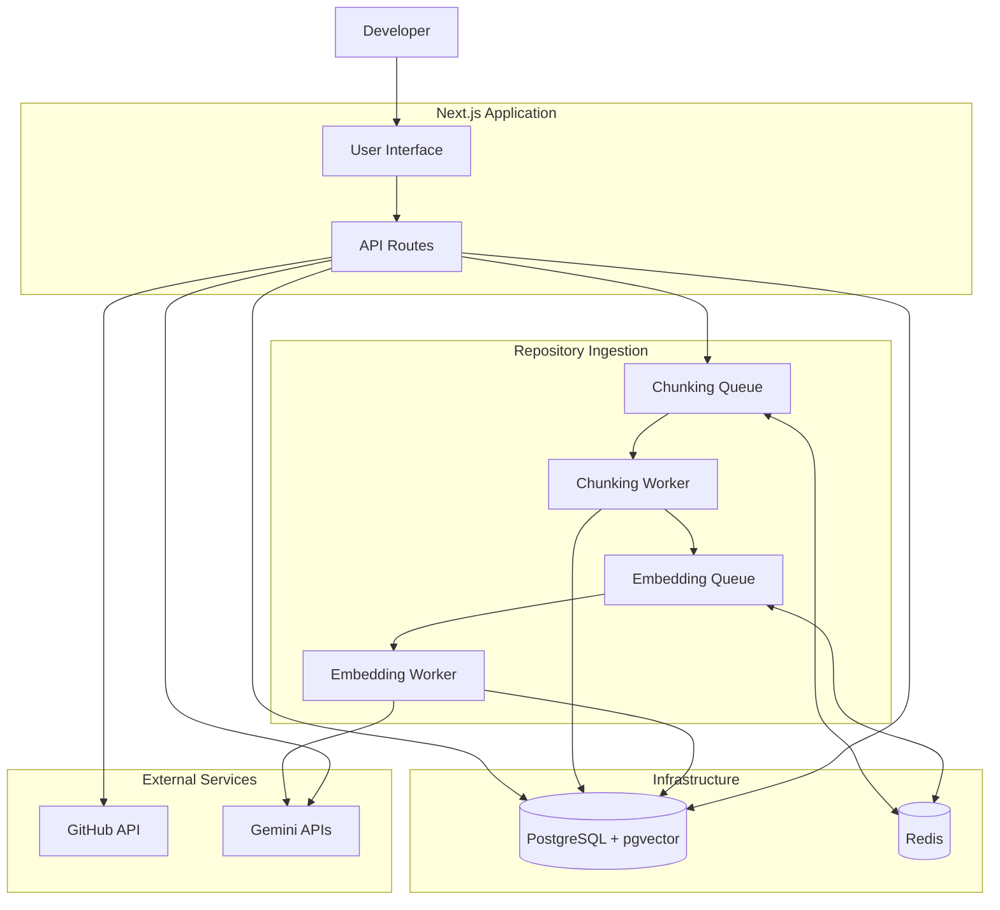
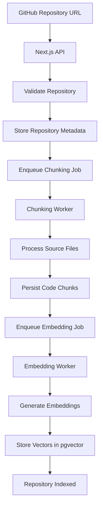
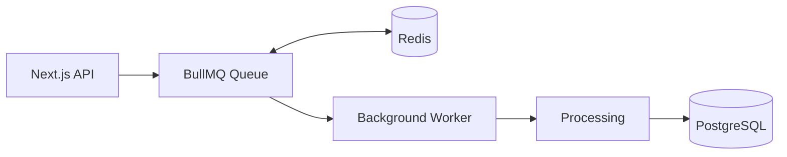
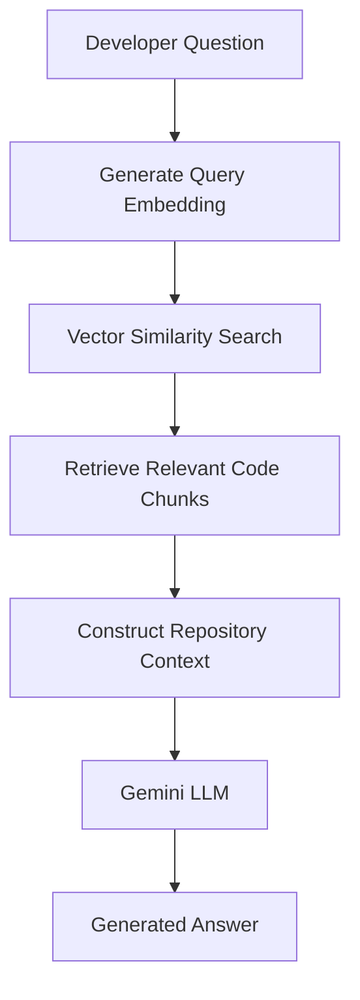
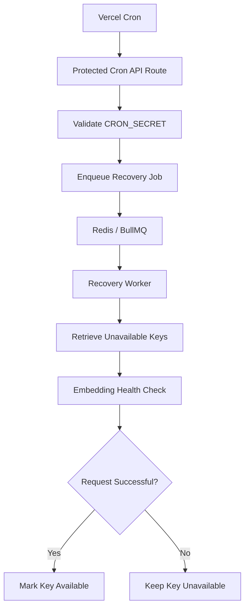

# DevFlow AI — Architecture & Engineering Decisions

This document explains the architecture behind DevFlow AI, the reasoning behind its major engineering decisions, and the improvements introduced to make repository processing more reliable.

It focuses on the system's internal workflows rather than just listing the technologies used.

---

## 1. Project Overview

DevFlow AI is a repository-aware AI assistant designed to help developers understand and explore existing GitHub codebases.

The central engineering challenge is providing an LLM with relevant information from a repository without sending the entire codebase with every question.

To address this, DevFlow AI uses Retrieval-Augmented Generation (RAG).

The application processes repository source files, divides them into smaller chunks, generates vector embeddings, and stores those embeddings in PostgreSQL using pgvector.

When a developer asks a question, the application generates an embedding for that question, retrieves relevant code chunks through vector similarity search, and provides the retrieved context to an LLM.

The system is organized around two primary workflows:

1. Repository ingestion and indexing.
2. Context retrieval and answer generation.

Long-running ingestion tasks are handled asynchronously using BullMQ and Redis rather than being executed within the lifetime of an HTTP request.

---

## 2. High-Level Architecture

The following diagram illustrates the major components and how they interact.

### Component responsibilities

| Component        | Responsibility                                              |
| ---------------- | ----------------------------------------------------------- |
| Next.js          | Application interface and API layer                         |
| GitHub API       | Repository information and source retrieval                 |
| PostgreSQL       | Repository metadata and code chunk storage                  |
| pgvector         | Vector embedding storage and similarity search              |
| Redis            | Backend storage for queued jobs                             |
| BullMQ           | Job creation, queue management, and processing coordination |
| Chunking Worker  | Repository source processing and chunk persistence          |
| Embedding Worker | Embedding generation and vector persistence                 |
| Gemini           | Embedding generation and LLM-based answer generation        |

The separation between application requests, background workers, storage, and external AI services is intentional. Each component has a defined responsibility, making the system easier to reason about and extend.

---

## 3. Repository Ingestion Pipeline

Repository ingestion transforms a GitHub repository into searchable information.

The pipeline consists of two main processing stages: chunking and embedding.

### 3.1 Repository submission

The developer submits an existing GitHub repository URL through the application.

The Next.js API layer:

1. Validates and parses the repository URL.
2. Retrieves the required repository information.
3. Stores repository metadata in PostgreSQL.
4. Enqueues a repository chunking job in BullMQ.

The API does not need to wait for the complete ingestion process to finish before responding.

This keeps the initial request separate from potentially long-running repository processing.

### 3.2 Chunking

A chunk is a smaller portion of a source file that can be processed and retrieved independently.

Sending an entire repository to an embedding model is impractical because repositories can contain many files and large amounts of source code.

Chunking divides the source code into manageable pieces.

The chunking worker is responsible for processing repository files and persisting the resulting chunks in PostgreSQL.

Once chunking has completed, the next processing stage can begin.

### 3.3 Embedding generation

An embedding is a numerical representation of text that captures semantic information.

It allows the application to compare the meaning of a question with the meaning of stored code chunks.

The embedding worker:

1. Retrieves the chunks that require embeddings.
2. Sends them to the Gemini embedding API.
3. Receives vector representations.
4. Stores the vectors in PostgreSQL using pgvector.

The embedding process is separated from chunking because it involves external API requests and provider-side usage limits.

### Ingestion workflow

### Why separate chunking and embedding?

These stages have different responsibilities and failure characteristics.

| Chunking                                | Embedding                                   |
| --------------------------------------- | ------------------------------------------- |
| Processes repository source files       | Communicates with an external AI API        |
| Produces code chunks                    | Produces numerical vectors                  |
| Primarily handles repository processing | Subject to provider quotas and API failures |
| Stores chunk records                    | Stores embedding vectors                    |

Keeping them separate makes it easier to retry embedding generation without unnecessarily repeating the entire repository-processing stage.

It also allows each stage to evolve independently.

---

## 4. Asynchronous Job Processing

### The problem with synchronous processing

Repository ingestion can involve downloading source files, processing them, generating chunks, and making numerous embedding API requests.

Executing all these operations inside a single HTTP request introduces several problems:

- Long response times.
- Request timeout risks.
- Poor separation of application and processing responsibilities.
- Limited control over retries and failure recovery.
- External API delays affecting the user-facing request.

### The queue-based approach

DevFlow AI uses BullMQ with Redis to manage background jobs.

The application creates jobs, and dedicated workers process them independently.

### Queue versus worker

These two concepts have different responsibilities.

**Queue**

A queue stores and manages jobs waiting to be processed.

For example, a repository embedding job can be added to the embedding queue without performing the embedding operation immediately.

**Worker**

A worker consumes jobs from a queue and executes the associated processing logic.

For example, the embedding worker retrieves a repository ID from a job and processes the chunks that still need embeddings.

### Why BullMQ and Redis?

BullMQ provides job-management functionality such as:

- Background job processing.
- Retry policies.
- Exponential backoff.
- Worker concurrency configuration.
- Job lifecycle management.

Redis provides the underlying storage and coordination required by BullMQ.

This architecture separates long-running work from the request-response lifecycle and gives the application more control over processing failures.

### Worker separation

DevFlow AI uses separate workers for:

- Repository chunking.
- Embedding generation.

The workers are deployed using Vercel Daemons.

This allows the application and its background processing infrastructure to operate independently.

---

## 5. RAG Retrieval and Answer Generation

Retrieval-Augmented Generation allows an LLM to answer questions using information retrieved from an external knowledge source.

In DevFlow AI, that knowledge source is the indexed repository.

### 5.1 Query embedding

When a developer asks a question, the application generates an embedding for the question using the Gemini embedding API.

This converts the question into a vector representation that can be compared with the stored repository embeddings.

### 5.2 Vector similarity search

The generated query embedding is compared with the repository's stored embeddings using pgvector.

The database retrieves code chunks with similar vector representations.

These chunks provide the relevant repository context for answering the question.

### 5.3 Context construction

The retrieved chunks are assembled into context for the LLM.

Instead of passing the entire repository, the application provides a smaller set of relevant code sections.

This reduces unnecessary context and focuses the model on information related to the developer's question.

### 5.4 Answer generation

The retrieved context and developer question are sent to the Gemini LLM.

The model uses the supplied repository context to generate an answer.

### Retrieval workflow

### Why RAG instead of sending the entire repository?

Sending an entire repository with every question is inefficient and does not scale well.

RAG provides several advantages:

- Retrieves information relevant to the current question.
- Reduces unnecessary input context.
- Separates knowledge storage from answer generation.
- Allows the indexed repository to be searched independently of the LLM.
- Provides a foundation for future retrieval improvements.

RAG does not guarantee that every answer will be correct. Retrieval quality, chunk quality, context construction, and model behavior all influence the final result.

---

## 6. Embedding API-Key Management

Embedding generation depends on an external API, which introduces provider-side limits and failures.

For example, Gemini may reject embedding requests when usage limits are reached.

Repeatedly sending requests with a key that is already failing can result in unnecessary API errors and wasted processing attempts.

To improve handling of these failures, DevFlow AI implements an embedding API-key manager.

### Key availability

The manager tracks the availability of configured embedding API keys.

A key can have one of two states:

- **Available:** Eligible for normal API-key selection.
- **Unavailable:** Temporarily excluded from normal selection.

The manager provides round-robin key selection and methods for marking keys available or unavailable.

When an embedding request fails with an error that requires the key to be excluded, the manager marks that key unavailable.

Normal key selection then skips it.

### Why use an API-key manager?

Without availability tracking, the application could repeatedly select a key that has already encountered a provider-side failure.

The manager provides a centralized place to handle key selection and availability.

It also provides a foundation for scheduled recovery.

### Important limitation

The current key manager stores availability state in memory.

This means that if the embedding worker process restarts, the in-memory state is reinitialized.

Persistent key availability across worker restarts is a potential future improvement.

Additionally, multiple API keys associated with the same Google Cloud project should not be assumed to provide independent project-level quotas.

---

## 7. Scheduled API-Key Recovery

Marking an API key unavailable prevents normal processing from repeatedly selecting it, but the system also needs a way to determine when that key can be used again.

DevFlow AI implements a scheduled recovery workflow using Vercel Cron and BullMQ.

### Recovery architecture

### Recovery process

1. Vercel Cron invokes the protected recovery endpoint.
2. The endpoint validates the cron authorization secret.
3. A recovery job is added to the recovery queue.
4. The recovery worker retrieves unavailable embedding keys.
5. Each candidate key is tested using a small embedding request.
6. Successful keys are marked available.
7. Keys that fail the health check remain unavailable.

The recovery worker uses the existing embedding request functionality rather than maintaining a separate implementation of the Gemini API request.

### Why use a scheduled job?

Provider-side limits may prevent embedding requests from succeeding for an extended period.

A scheduled recovery workflow allows the system to test unavailable keys later without requiring manual intervention or continuously retrying failed requests.

### Why keep recovery in the embedding worker process?

The key manager currently maintains its state in memory.

The recovery worker therefore runs in the same Node.js process as the embedding worker, allowing both workers to access the same manager instance.

Running recovery in a completely separate process would create a separate in-memory manager and would not automatically update the embedding worker's state.

### Security

The cron endpoint is protected using a shared secret configured through the `CRON_SECRET` environment variable.

The endpoint validates the authorization header before enqueuing recovery work.

The cron endpoint schedules recovery; the worker performs the actual health checks.

A successful health check only confirms that the tested request succeeded at that moment. It does not guarantee that future requests will remain within provider limits.

---

## 8. Rate Limiting

DevFlow AI uses Vercel WAF rules to apply rate limiting at the platform edge.

Rate limiting helps control excessive incoming traffic before it reaches application functions.

### Why edge-level rate limiting?

Without request-level controls, excessive traffic can increase pressure on:

- Next.js API routes.
- Database connections.
- External GitHub API requests.
- Gemini API usage.
- Application infrastructure.

Applying rate limiting at the edge helps reduce unnecessary requests before they reach the application.

### Current implementation

Rate limiting is configured through Vercel WAF rather than a custom application-level Redis rate limiter.

This avoids introducing another application-level dependency for the current use case.

### Scope and limitations

Edge-level rate limiting is not a replacement for:

- User authentication.
- Resource-level authorization.
- User-specific usage quotas.
- Application-level business rules.

These concerns will become more important when authenticated multi-user access is introduced.

---

## 9. Engineering Decisions and Trade-offs

The following table summarizes the major architectural decisions and the reasoning behind them.

| Decision                                | Reasoning                                                                               | Trade-off                                                 |
| --------------------------------------- | --------------------------------------------------------------------------------------- | --------------------------------------------------------- |
| Next.js App Router                      | Provides the application interface and API layer within one framework.                  | Application and API concerns share a codebase.            |
| PostgreSQL                              | Stores repository metadata and code chunks in a relational database.                    | Requires database schema and migration management.        |
| pgvector                                | Enables vector storage and similarity search alongside application data.                | Retrieval quality depends on embeddings and query design. |
| Drizzle ORM                             | Provides typed database queries and schema management.                                  | Requires explicit schema and migration maintenance.       |
| BullMQ and Redis                        | Moves long-running work outside HTTP requests.                                          | Introduces Redis and worker infrastructure to operate.    |
| Separate chunking and embedding workers | Isolates processing stages with different responsibilities and failure characteristics. | Adds queue coordination and deployment complexity.        |
| Gemini embeddings                       | Provides vector representations for repository chunks and questions.                    | Subject to external API availability and usage limits.    |
| API-key availability manager            | Prevents normal selection of keys marked unavailable.                                   | Current availability state is in memory.                  |
| Vercel Cron recovery                    | Provides scheduled recovery checks without continuous polling.                          | Recovery happens on a schedule rather than immediately.   |
| Vercel WAF rate limiting                | Controls excessive incoming traffic at the edge.                                        | Does not implement user-specific authorization or quotas. |

The architecture favors separation of responsibilities and controlled asynchronous processing over executing the entire ingestion workflow synchronously.

---

## 10. Reliability and Failure Handling

Several improvements have been introduced to make repository processing more resilient.

### Asynchronous processing

BullMQ separates repository-processing work from the lifetime of a Next.js HTTP request.

Jobs can be queued and processed independently by the appropriate worker.

### Retry and failure handling

Queue-level retry policies help handle transient failures.

Retries alone do not guarantee successful processing. Job operations should be designed with idempotency in mind so that retrying work does not unnecessarily duplicate or corrupt stored data.

Permanent provider errors also require explicit handling rather than being treated as indefinitely retryable failures.

### Embedding API-key availability

The key manager tracks available and unavailable embedding keys.

Failed keys are skipped by normal selection until they are restored.

### Scheduled recovery

A protected cron endpoint adds a job to the recovery queue.

The recovery worker tests unavailable keys using the existing embedding request function and marks successful keys available.

### Platform rate limiting

Vercel WAF rules provide an edge-level control against excessive incoming API traffic.

Application-level authorization and usage quotas remain separate concerns.

---

## 11. Current Limitations

DevFlow AI is an actively developed portfolio project. The current implementation focuses on the core AI and backend infrastructure.

The following limitations are known and should be considered when evaluating the current system.

### Authentication and authorization

Authentication and user-level authorization have not yet been implemented.

The current application does not associate repositories, conversations, or background jobs with authenticated user accounts.

User identities, resource ownership, and authorization checks are planned before introducing multi-user access.

### In-memory API-key availability

The embedding API-key manager stores availability state in memory.

A worker restart can reset this state because it is not persisted in the database or Redis.

### Retrieval improvements

The current retrieval implementation uses vector similarity search.

Hybrid search, reranking, and systematic retrieval evaluation are potential improvements.

### Incremental repository indexing

Incremental indexing based on repository changes is planned.

This would allow the system to process changed files rather than re-indexing an entire repository.

### Conversation persistence

Persistent, user-associated conversation management remains future work.

### Observability

More comprehensive monitoring, metrics, and alerting for background workers and external API failures remain areas for improvement.

---

## 12. Future Improvements

The following improvements represent the planned direction of the project.

- [ ] Implement authentication and user-level authorization.
- [ ] Associate repositories and conversations with users.
- [ ] Enforce resource ownership across API routes and background jobs.
- [ ] Persist embedding API-key availability state.
- [ ] Implement incremental repository indexing.
- [ ] Improve code-aware chunking.
- [ ] Explore hybrid search and reranking.
- [ ] Introduce retrieval and answer-quality evaluation.
- [ ] Improve observability and background-job monitoring.
- [ ] Expand source-grounded answers and citation handling.
- [ ] Improve repository-level security and input validation.

These improvements are intended to strengthen the existing architecture rather than replace its core design.

---

## 13. Deployment and Infrastructure

The application uses Vercel for deployment and managed infrastructure for its supporting services.

The deployment architecture includes:

| Service        | Purpose                                |
| -------------- | -------------------------------------- |
| Vercel         | Next.js application hosting            |
| Vercel Daemons | Background worker execution            |
| Vercel Cron    | Scheduled recovery workflow            |
| Vercel WAF     | Edge-level rate limiting               |
| PostgreSQL     | Application data and vector storage    |
| Redis          | BullMQ job storage and coordination    |
| Google Gemini  | Embedding generation and LLM responses |
| GitHub API     | Repository integration                 |

The background workers run independently from the Next.js application request lifecycle.

The cron endpoint schedules recovery work, while the recovery worker performs the actual checks.

---

## Conclusion

DevFlow AI explores the engineering challenges involved in building an AI application around real software repositories.

The project combines repository processing, semantic retrieval, vector storage, external AI services, asynchronous job execution, and reliability mechanisms into one system.

Its focus is not just integrating an LLM, but understanding and engineering the infrastructure that makes repository-aware AI applications practical.

The architecture is actively evolving, with authentication, improved retrieval, incremental indexing, and stronger observability identified as future areas of development.
