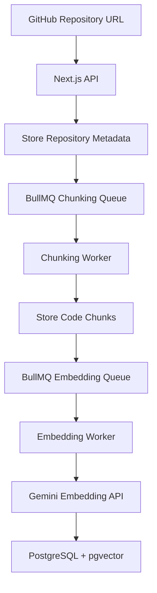
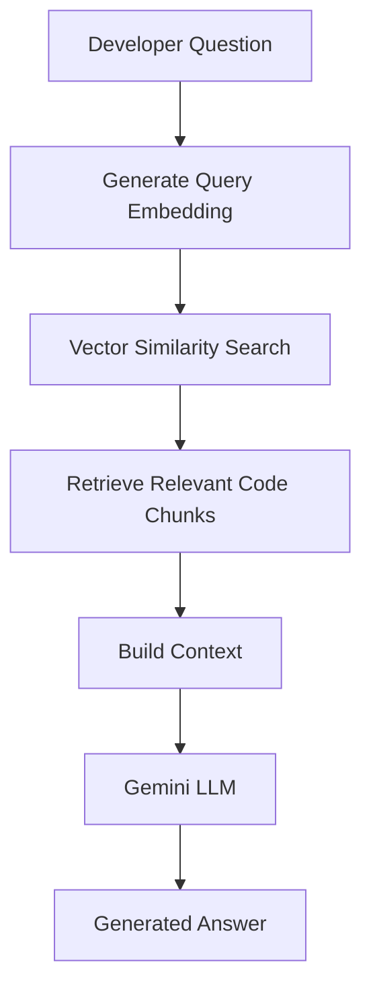

# DevFlow AI

**A repository-aware AI assistant that helps developers understand and explore codebases using Retrieval-Augmented Generation (RAG).**

DevFlow AI connects GitHub repositories to an AI-powered question-answering system. Instead of sending an entire codebase to an LLM, it processes source files, generates embeddings, stores them in a vector database, and retrieves relevant code context when a developer asks a question.

The project explores practical AI application engineering, including RAG pipelines, vector search, asynchronous job processing, API integration, and reliability engineering.

---

## Overview

Understanding an unfamiliar codebase can require significant time spent navigating files, tracing dependencies, and locating relevant implementation details.

DevFlow AI aims to make this process easier by allowing developers to submit a GitHub repository and ask questions about its code.

The application processes the repository asynchronously, indexes its source code, and uses semantic retrieval to provide relevant context to an LLM before generating an answer.

The focus is not simply building another chatbot. It is designing the infrastructure required to make an AI assistant work with real software repositories.

## Features

### Repository-aware AI assistance

- Submit an existing GitHub repository.
- Process repository source files for indexing.
- Ask questions about the repository using natural language.
- Retrieve relevant code context using vector similarity search.
- Generate context-aware answers using Gemini.

### Retrieval-Augmented Generation

- Generate vector embeddings from repository code chunks.
- Store embeddings in PostgreSQL using pgvector.
- Convert user questions into query embeddings.
- Retrieve semantically relevant code chunks.
- Provide retrieved context to the LLM for answer generation.

### Asynchronous repository processing

- Use BullMQ and Redis to move long-running processing outside HTTP request lifecycles.
- Separate repository chunking and embedding into dedicated background workers.
- Process embedding jobs independently from repository chunking.
- Apply queue-level retry and failure-handling policies.

### API reliability

- Manage embedding API-key availability.
- Skip keys marked unavailable during normal key selection.
- Schedule recovery checks for unavailable keys.
- Use Vercel Cron to trigger recovery workflows.
- Apply Vercel WAF rate-limiting rules to incoming traffic.

---

## Architecture

DevFlow AI has two primary workflows: repository ingestion and question answering.

### 1. Repository ingestion

Repository ingestion prepares source code for semantic retrieval.



The ingestion process is asynchronous. The API handles repository submission and job creation, while background workers perform the longer-running processing tasks.

Separating chunking and embedding allows each stage to be processed independently and keeps long-running AI operations outside the request-response lifecycle.

### 2. Question answering

When a developer asks a question, DevFlow AI retrieves relevant code context before generating an answer.



This follows the Retrieval-Augmented Generation (RAG) approach.

Rather than relying only on the LLM's existing knowledge, the system retrieves relevant information from the indexed repository and uses it as additional context.

---

## Technology Stack

| Category               | Technology           |
| ---------------------- | -------------------- |
| Framework              | Next.js (App Router) |
| Frontend               | React, TypeScript    |
| Styling                | Tailwind CSS         |
| Database               | PostgreSQL           |
| Vector Search          | pgvector             |
| ORM                    | Drizzle ORM          |
| Background Jobs        | BullMQ               |
| Queue Storage          | Redis                |
| AI Models              | Google Gemini        |
| Repository Integration | GitHub API           |
| Deployment             | Vercel               |
| Scheduled Tasks        | Vercel Cron          |

---

## Engineering Highlights

The project involves several engineering decisions beyond integrating an LLM API.

### Asynchronous job processing

Repository processing can take longer than a typical HTTP request, particularly when generating embeddings for many code chunks.

BullMQ and Redis provide a queue-based architecture that allows the application to enqueue work and process it independently using background workers.

Separate workers handle chunking and embedding, keeping the responsibilities of each processing stage isolated.

### Embedding API-key management

Embedding requests can fail because of provider-side limits or temporary API errors.

DevFlow AI uses an API-key manager to track key availability and avoid repeatedly selecting keys marked unavailable.

A scheduled recovery workflow tests unavailable keys with an embedding request and restores keys that successfully pass the check.

### Edge-level rate limiting

Vercel WAF rules provide rate limiting at the platform edge, helping control excessive incoming traffic before it reaches application functions.

This is separate from application-level authentication, authorization, and user-specific usage quotas, which remain future work.

For a deeper explanation of the architecture and these engineering decisions, see [`docs/ARCHITECTURE.md`](ARCHITECTURE.md).

---

## Getting Started

### Prerequisites

Make sure you have the following installed:

- Node.js
- pnpm
- PostgreSQL with the pgvector extension
- Redis
- A GitHub API access configuration, if required by your implementation
- Google Gemini API credentials

### Installation

Clone the repository:

```bash
git clone https://github.com/UzairMalik17/devflow-ai.git
cd devflow-ai
```

Install dependencies:

```bash
pnpm install
```

### Environment configuration

Create a `.env` file in the project root and configure the environment variables required by the application.

These include the database connection, Redis connection, and Gemini API credentials.

Use the project's environment configuration and source code as the authoritative reference for the exact variable names and required values. Never commit API keys, database credentials, or other secrets.

### Database setup

Generate and apply the Drizzle migrations using the project's database scripts:

```bash
pnpm db:generate
pnpm db:migrate
```

Ensure PostgreSQL has the pgvector extension available before applying migrations that create vector columns.

### Run the application

Start the Next.js development server:

```bash
pnpm dev
```

Run the background workers in separate terminal sessions using the project's worker scripts:

```bash
pnpm worker:chunking
```

```bash
pnpm worker:embedding
```

Open [http://localhost:3000](http://localhost:3000) to access the application.

> Background workers require a working Redis connection and the appropriate environment configuration. Follow the deployment configuration when running the complete system.

---

## Current Scope and Limitations

DevFlow AI is an actively developed software engineering portfolio project. Its current development phase focuses on the core AI and backend infrastructure.

The following capabilities are not yet implemented:

- **Authentication and authorization:** The application does not currently provide user accounts or user-level resource ownership.
- **Persistent user conversations:** Persistent, user-associated conversation management remains future work.
- **Incremental repository indexing:** Re-indexing only changed files based on repository updates remains planned.
- **Advanced retrieval:** Hybrid search and reranking are potential improvements to retrieval quality.
- **Evaluation infrastructure:** A dedicated benchmark for measuring retrieval and answer quality remains planned.

Authentication and resource-level authorization will be required before introducing multi-user access and broader production use.

---

## Roadmap

- [ ] Implement authentication and user-level authorization.
- [ ] Associate repositories and conversations with users.
- [ ] Implement incremental repository indexing.
- [ ] Improve code-aware chunking and retrieval.
- [ ] Explore hybrid search and reranking.
- [ ] Introduce retrieval and answer-quality evaluation.
- [ ] Improve observability and background-job monitoring.
- [ ] Expand source-grounded answers and citation handling.

---

## Project Documentation

For more information about the implementation and engineering decisions:

- **[Architecture Documentation](docs/ARCHITECTURE.md)** — Detailed system architecture, processing workflows, infrastructure, and engineering trade-offs.
- **In-app Documentation** — Architecture diagrams, implementation decisions, reliability improvements, and project roadmap.

---

## Author

**Uzair Akbar Malik**

Software Engineer | Full-Stack Development | AI-Integrated Applications

- [GitHub](https://github.com/UzairMalik17)
- [Portfolio](https://portfolio-olive-zeta-82.vercel.app/)

---

_DevFlow AI is an actively developed portfolio project exploring practical AI engineering and reliable software systems._
